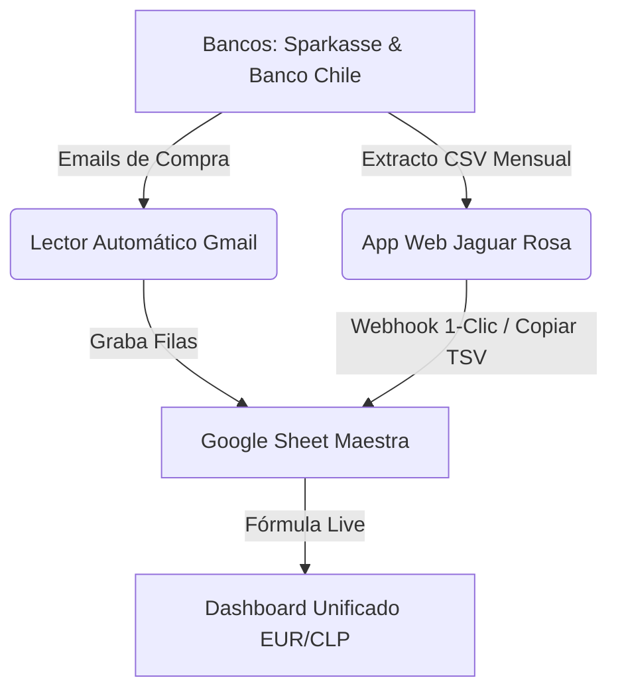

# 📖 Guía de Monitoreo Bancario Integrado: Sparkasse & Banco Chile

Esta guía explica cómo mantener un **control total y sin fricción de tus finanzas personales**, combinando las cuentas de **Sparkasse (EUR €)** y **Banco Chile (CLP $)** en una sola planilla de Google Spreadsheets conectada a tu aplicación web *Jaguar Rosa*.

---

## 🎯 Componentes del Sistema

1. **Lector Automático Gmail**: Detecta las notificaciones que envían los bancos por correo al hacer compras o transferencias y las anota en la planilla.
2. **App Web Jaguar Rosa**: Te permite arrastrar archivos CSV (ej. [`Ejemplo_Sparkasse_Extracto.csv`](file:///Users/danielsantander/Documents/Desarrollo%20Personal/Ejemplo_Sparkasse_Extracto.csv) o [`Ejemplo_Banco_Chile_Extracto.csv`](file:///Users/danielsantander/Documents/Desarrollo%20Personal/Ejemplo_Banco_Chile_Extracto.csv)), ver tus dashboards de Ocio y presionar **"Sincronizar con Google Sheets"**.
3. **Google Sheet Maestra**: Convierte automáticamente de CLP a EUR en tiempo real con `=GOOGLEFINANCE("CURRENCY:EURCLP")`.

---

## 🛠️ Paso 1: Configurar tu Google Sheet con Apps Script

1. Abre una nueva planilla en [Google Sheets](https://sheets.google.com).
2. Ve al menú superior: **Extensiones** ➔ **Apps Script**.
3. Reemplaza cualquier código existente pegando el contenido del archivo [`finanzas/GoogleAppsScript_Sync.js`](file:///Users/danielsantander/Documents/Desarrollo%20Personal/finanzas/GoogleAppsScript_Sync.js).
4. En el menú desplegable de funciones de Apps Script, selecciona `setupSpreadsheetStructure` y presiona **Ejecutar**.
   * *Esto creará automáticamente las pestañas `Dashboard_Unificado`, `Movimientos_EUR` y `Movimientos_CLP` con sus colores y fórmulas de tipo de cambio.*

---

## 🌐 Paso 2: Activar el Webhook de Sincronización

Para que tu App Web local pueda enviar datos a Google Sheets con 1 solo clic:

1. En la ventana de Apps Script, haz clic en el botón azul **Desplegar** ➔ **Nuevo despliegue**.
2. En el ícono de engranaje (⚙️), selecciona **Aplicación Web**.
3. Ajusta la configuración:
   * **Descripción**: Webhook Jaguar Rosa Finanzas
   * **Ejecutar como**: Tu cuenta (Yo)
   * **Quién tiene acceso**: **Cualquier persona** (*Anyone*)
4. Presiona **Desplegar** y concede los permisos de lectura/escritura en tu cuenta de Google.
5. **Copia la URL del despliegue WebApp** (termina en `/exec`).
6. Pega esa URL en la sección **Finanzas** de tu aplicación web *Jaguar Rosa*.

---

## 📧 Paso 3: Activar la Lectura Automática desde Gmail (Opcional)

Si deseas que cada notificación de correo de Banco Chile o Sparkasse agregue una fila sola a tu Google Sheet:

1. En Apps Script, ve al panel izquierdo y haz clic en **Activadores** (icono de Reloj ⏰).
2. Haz clic en **Añadir activador** (botón azul abajo a la derecha).
3. Configura:
   * **Seleccionar qué función ejecutar**: `processBankNotificationEmails`
   * **Seleccionar fuente del evento**: *Según tiempo* (Time-driven)
   * **Tipo de activador basado en hora**: *Temporizador por horas* (Every hour)
4. Presiona **Guardar**. ¡Listo! Cada hora revisará si llegaron correos nuevos del banco y los anotará en tu hoja.

---

## 📊 Paso 4: Carga Manual Rápida o CSV (Zero-Friction)

Cuando quieras procesar extractos completos del mes:
* En tu App Web *Jaguar Rosa*:
  * Usa el **Cargador de Archivos CSV** para subir el resumen exportado de tu banco.
  * O usa el botón **"Copiar en formato TSV"** para pegar directamente en tu Google Sheet presionando `Ctrl+V`.
